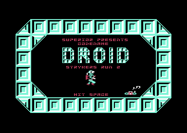
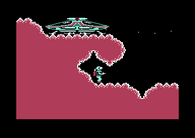
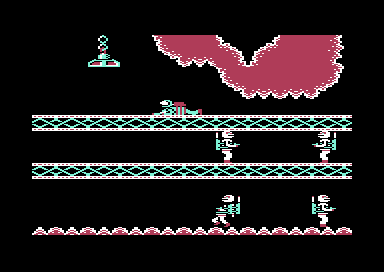

# Codename Droid: Stryker's Run Part 2

**Codename Droid** (Superior Software, 1987, by Martin Edmondson and Nick Chamberlain) for the BBC Micro, rebuilt from its
disassembly, and a **Commodore 64 port**: a C64-native engine that follows the BBC game's rules on a character-mode display
with smooth scrolling.

This is an AI port using Claude by Rad Restoration - contact@radrestoration.com.

Tested in VICE (the rewrite has not been through a complete play-through yet).

  
  
  

## Copyright and Ownership

Like many BBC Micro games, this software is considered abandonware, and the copyright status is unclear. 

This work was based upon disassembly here:

https://level7.org.uk/miscellany/codename-droid-disassembly.txt

For more on the original, see here:

https://bbcmicro.co.uk/game.php?id=564

## Download

`make zip` builds the release zip (see Building). Published releases are available on
[GitHub Releases](https://github.com/radrestoration/CodenameDroid/releases).

## Commodore 64 Port Notes

The game aims to be a faithful port of the original, but there are some concessions:

 - The original BBC Micro game ran in Mode 5, which is 256 pixels vertically with a reduced width of 256 (actually, 128,
   because the pixels are rectangular). The Commodore 64 version instead uses a play area of 320 (160 pixels) x 200 to give
   a rectangular play area of about the same area: 40 columns of cells instead of the BBC's 32, and a "camera follow" that
   shows 25 of the level's 32 rows. The rules are the BBC's, ported routine by routine, and checked against the BBC game.
 - Joystick - the game is not playable with the joystick alone, it is really a keyboard driven game as most BBC Micro 
   games were. This would require some major thinking and work to accomodate a fully joystick driven game. 
 - Music and sound - the conversion is pretty good, but the BBC Micro's sound chip and the C64 SID are fundamentally different
   instruments. 
 - Loading screens - poorly done because of the attempt to squeeze in graphics from one set of hardware restrictions to another. 

Otherwise, the game play and game play graphics, allowing for differences in palette, follow the original.
The player and the bullets are C64 hardware sprites; everything else is rendered in character mode.

## Running the C64 version

With VICE (`x64sc`): `./run.sh` (PAL), `./run.sh ntsc`, `./run.sh intro` (from the disk image), `./run.sh warp`. `./run.sh cheat` is the test build. In the
release zip that is the `run.sh` beside `game.prg` and `droid.d64`; in the source tree `./run.sh` builds first. Or load
`droid.d64` yourself (`LOAD"DROID",8,1`, `RUN`; it loads the game after the loading screens), or `game.prg` (it starts at the
title). The program detects PAL and NTSC itself.

In the source tree, `intro` autostarts the loading-screen program and attaches the disk as VICE's virtual device 8
for the subsequent game load. The release zip uses `./run.sh d64` for the disk instead.

It starts as the BBC disc does:
1. the instruction pages from the tape inlay (SPACE for each; RUN/STOP skips them),
2. the logo, then the full screen artwork scrolling up (any key moves on),
3. the credits: SPACE (or fire) starts the game, V shows the controls.

### Controls

| | keyboard | joystick (port 2) |
|---|---|---|
| walk | Z / X | left / right |
| up (climb, lift, stand) / down (kneel, crawl, descend) | `;` / `/` | up / down |
| jump (hold Z or X for a sideways jump) | RETURN | fire |
| fire the blaster | `=` | |
| wrist terminal / jet pack screen | A / J | |
| drop a mine / leave the jet pack | D / O | |
| pause / resume | P / DEL | |
| lose a life / give up | CTRL / RUN/STOP | |
| sound off / on | F1 / F3 | |

On the wrist terminal: S and B charge the suit and the blaster, M shows the map, SPACE leaves. The joystick controls are
provisional.

## Running the BBC version

The BBC game is rebuilt bit for bit from the disassembly (`bbc/`). From `bbc/`: `make run` starts b-em on the rebuilt disc
(see `tools.cfg`). Details in `bbc/README.md`.

## Building

You need cc65 (`ca65`, `ld65`), Python 3 with numpy and Pillow, and `c1541` (part of VICE). Copy `tools.cfg.tmpl` to
`tools.cfg` if cc65 is not on your path. The loading screens are made from the original disc image
(`Disc032-CodenameDroidStrykersRun2.ssd`, set `DISC` if it is not in `~/retro/games`); without it the build has no loading
screens. The build itself needs nothing from a BBC ROM.

    make            build/c64/game.prg and (with the original disc) droid.d64 containing the intro and game
    make CHEAT=1    the test build in build/c64-cheat: keys 1-9, 0, Q, W go to levels 1-12 (at the lift the player arrives by), E fills energy, pass
                    cards and cells, R gives the microfilm, the key and the spanner, T the jet pack; the player cannot die
    make PROFILE=1  the border shows the time: blue the game, red the screen matrix
    make zip        build/c64/codename-droid-c64.zip: the PRG, the disk image, run.sh and this file
    make test       the headless checks in the 6502 simulator (no emulator)
    make help

The disk image and release zip require the original BBC disc image; without it, `make` builds the standalone game PRG only.

## Releasing

Release builds also require `zip`, `sha256sum` and Git. Commit all changes first, and add release notes under a
`## vX.Y.Z` heading in `CHANGELOG.md`.

    make release                    versioned zip and SHA256SUMS in build/release/
    make publish TAG=v1.0.0 DRY=1   check the release notes and show what would happen
    make publish TAG=v1.0.0         build, tag, push to origin and create a GitHub release

Publishing requires `gh` authenticated for this repository. Tags containing a hyphen create prereleases.
The release zip includes `VERSION.txt` with the version, commit and build time. A full play-through and the
intro-to-game loading sequence are still outstanding checks before publication.

## How the game works

Keys are as in the controls table above.

- **The level** (`src/level.s`): at level load the BBC's tiles (4 x 4 cells, from the BBC game's own tile art, flips and all)
  are made into characters, each distinct 8-byte cell once (`intern`: hashed, compared), at most 203 a level.
  The level is `ROWS`, 32 rows of 256 character numbers, and `BPAT`, each character's BBC bytes, which the
  rules read as the BBC reads its screen. The map of tiles (`LTILES`, a page a level) is the BBC's, edited by the game's
  events (lifts, pillars, doors...).
- **The display** (`view.s`): a window of 40 x 25 cells onto `ROWS`, in two screen matrices (`$c800`, `$cc00`), one shown
  while the other is made (the shown one shifted by a block copy, a new column or row from `ROWS`), and the raster interrupt
  swaps them together with the VIC-II's fine scroll and the sprites, so nothing tears. 38-column mode hides the scroll's
  edges. The camera shows 25 of the level's 32 rows and moves by a row.
- **The player** is two sprites (21 + 11 lines; three for crawling, which is 7 cells wide), drawn exactly where the game's
  step has put it (the picture never glides: when the machine is slow the game takes several steps a frame, and a trailing
  picture would overlap the ground the game had already cleared); **blasters** are sprites 3 - 7; **enemies, objects, mines and explosions** are characters written
  into `ROWS` and both matrices (`put_cell`) as they change. Each visible enemy keeps the twelve cells under its picture so
  they can be put back; the character groups start after the current level's glyphs and scale to the available space, up to
  ten groups. Enemies and the player's collisions use the BBC's way: a point of the player's picture
  against the enemy's byte.
- **The rules** (`player.s`, `objects.s`, `enemy.s`, `blaster.s`, `events.s`) keep the BBC's names and order of play:
  `game_step` is its main loop without the display, run every 4 PAL frames (4.8 NTSC), as the BBC's loop took 4. The BBC keeps
  the player as a screen address; here `pc` (cell column) and `py` (line) are that address, `px` the BBC's `player_x`.
- **Screens** (`screens.s`, `title.s`): the wrist terminal, the map, the jet pack computer, game over and the completion
  screen are made of characters too (a backdrop of tiles as level 12 / 13, the BBC's font as shared glyph characters, its
  sprites composited into the cells under them); the title is the BBC's own screen, taken from the BBC game running in
  `tools/bbcsim.py`, with the player walking on the spot and firing.
- **Sound** is the SID driver (`src/sound.s`) with the BBC's sound calls (`sfx.s`).

## Memory

The program and sprite source blocks occupy `$0801-$9fff`. `$a000-$bfff` is `ROWS`; `$c000` is the active character set,
`$c800` / `$cc00` the screen matrices, and `$d000-$dfff` the sprites (VIC-II bank 3). The lift temporarily uses `$d000`
for its ride charset, `$d800` for the rebuilt level charset, and `$de80-$df3f` for the player's ride sprites; this all sits
under the I/O area, which the CPU maps out only while copying. `$e000` is `LTILES`, `$ee00` `BPAT`, `$f600` the sharing
tables, `$fa00` the sound driver's variables; `$0200` variables.

## Checking it

`tools/make_data.py` makes `game_data.inc` (tiles, levels, sprites, the title...) from the BBC game's own data.
`tools/sim_check.py` runs it headless (6502 simulator, a model of the raster, keys and interrupts) and renders the screen.
`tools/test_enemy_pool.py` checks the new-game start and character-group capacity on the two crowded early levels.
`tools/test_lift.py` exercises the ride, next-level rebuild, and charset/sprite display handoff in the raster simulator.
`tools/test_intro_loader.py` checks the intro loader's successful and failed KERNAL calls with a headless model; it does not
test a real disk drive.
`tools/test_vs_bbc.py [iterations] [seed] [deepest]` runs it against the BBC game with the same keys: after each pass
of the main loop the player's state, the energies, the objects carried and the enemies' variables must agree. They do, for
hundreds to thousands of iterations on levels 0, 3 and 6, with random play; where they differ the BBC's own pixels are the
cause (its sprites leave remnants and carve holes in the ground, which the rules then read; here the sprites are not in the
level). The collisions with enemy fire, mines and the terminal are not in that test.

## Differences from the BBC

- The picture scrolls smoothly; the player, the enemies and the rules move a cell at a time as on the BBC, the bullets smoothly.
- The screen shows 25 of the level's 32 rows (the camera), and 40 of its columns instead of 32.
- Sprites do not overwrite the background, so a player or an enemy in front of a rope or a chain leaves it showing.
- The title does not scroll in. The instruction pages, pictures and credits (`src/intro.s`) are a separate program,
  `intro/` -> `build/c64/intro.prg`: it loads `GAME` over itself (`droid.d64` has both; `game.prg` starts at the title).
  The intro-to-game disk loading sequence has not yet been verified end to end.
- A lift ride (`lift.s`) scrolls the 40 columns at the lift's end of the old and new levels past the fixed cabin and player.
  The new level is built into separate row/charset storage while the ride remains visible, then the display switches to the
  rebuilt level at landing without the former black rebuild.
- Mines exploding use the cell of the mine, not the half cell the BBC may use; the pillars of the shrine's sector three kill by
  a test of the player's four points against the pillar's cells.
